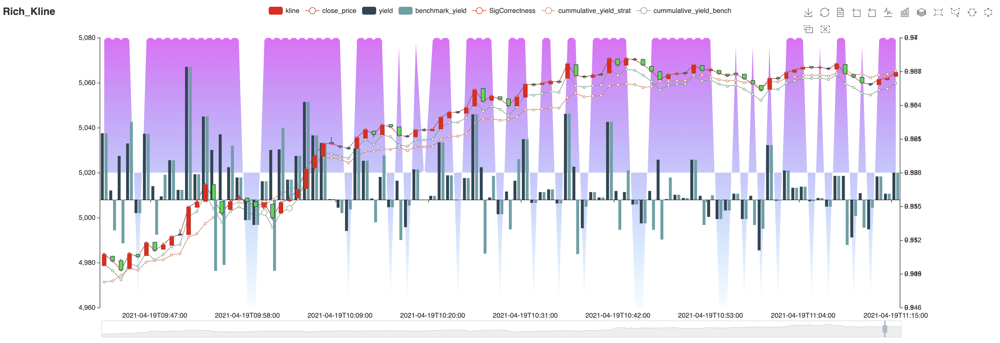

# Time Series Analysis

A 2021 Python research workspace for turning time-series factors into signals, running backtests, and reviewing results. The research notebooks and backtest share saved inputs, so you can inspect the signal-generation and evaluation steps separately.

*An archived research visualization showing candlesticks and signal overlays.*

## Trace a research run

| Step | Where to look |
| --- | --- |
| Explore a factor | [Notebook guide](notebook/Readme.md) and [factor modules](src/factor/) |
| Configure an evaluation | [Backtest configuration](src/backtest/test_config.py) |
| Run and inspect outputs | [Backtest entry point](src/backtest/backtest_entry.py) and [original documentation](README.md#visualization) |

The [requirements](requirements.txt) reflect the original 2021 environment. The historical workflow uses separate market data, factor, and signal inputs. For a new evaluation, supply authorized or synthetic data and reproduce the relevant configuration.

The [commit history](https://github.com/danni2019/time_series_analysis/commits/main/) dates the original development work. See [LICENSE](LICENSE) for the code license or [the Chinese README](README.md) for the full historical notes.
